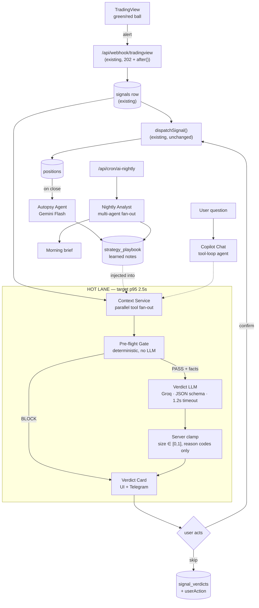

# Monarch Rebuild — Plan v5: Signal Copilot (AI agent layer)

Scope: an AI layer over the existing signal pipeline. The headline feature is a **Signal
Verdict** — when a TradingView alert lands on `/api/webhook/tradingview`, the user gets a
`TAKE / HALF / WAIT / SKIP` call with reasons, a size, and an invalidation level, inside
~2 seconds. Around that sit four slower AI lanes (deep review, post-trade autopsy, nightly
analyst, copilot chat) that share one provider router, one context service, one trace table.

Providers in scope: **Groq, OpenAI, Gemini**. Groq owns the hot path (latency), Gemini owns
the cheap bulk lanes, OpenAI owns the deep/reasoning lanes. All three are pluggable per
workspace.

---

## 0. The product problem, stated plainly

The indicator prints a ball. Green = long setup, red = short setup. Today that ball becomes
a webhook, becomes a `signals` row, becomes a broker order (`lib/strategies/execute.ts`) —
with zero judgment in between beyond cooldown and daily-cap rate limits
(`lib/strategies/rate-limits.ts`).

Every experienced trader running this stack does the same thing manually: they see the
alert, then in their head they check *is this one of the good ones?* — time of day, how the
strategy has been doing this week, what they already hold, whether there's an event in 20
minutes, whether the move already ran. Then they take it, halve it, or let it go.

**That head-check is the product.** It is the only step in the pipeline that is not
automated, it is applied inconsistently under time pressure, and it is exactly the shape of
work an LLM is good at: synthesize heterogeneous context into a short, defensible
recommendation. Everything else in this plan is scaffolding for that one moment.

Job to be done, in the user's words: *"tell me whether to take this ball or not, before the
move is gone, and tell me why in one line I can argue with."*

### What the AI must never do

The invariant that shapes the whole architecture:

> **The LLM can never cause money to be spent, and can never increase size.**

Hard risk rules stay in deterministic code. The model can only (a) recommend, (b) reduce
size within `[0, 1]`, (c) explain. A model outage degrades to a rule-only card, never to a
blocked or a wrong trade. Every design choice below falls out of this line.

---

## 1. Classification — what shape is this, actually

Walking the ladder honestly, because the wrong answer here is a 3× cost multiplier:

| Question | Answer | Consequence |
|---|---|---|
| Can one prompt do it? | No — needs live quotes, portfolio state, strategy history | Needs context assembly |
| Does it break into fixed sequential stages? | **Yes** — gather → gate → judge → render | Workflow, not free agent |
| Needs facts the model doesn't know? | Yes, but they're **structured** (Postgres, broker APIs, quotes) | Tool/SQL retrieval, *not* vector RAG |
| Must the model choose its own path at run time? | **No** in the hot path — the path is always the same | Fixed control flow wins: cheaper, testable, bounded latency |
| Genuinely parallel, isolated sub-problems? | Only in the slow lanes | Multi-agent earns its place in 2 of 5 lanes |

**Verdict on architecture: a deterministic workflow with one LLM step in the hot path,
inside a multi-lane system where only the slow lanes are multi-agent.**

Resisting the obvious temptation: a "signal analysis crew" with a Market Analyst, a Risk
Analyst, a Technical Analyst and a Judge all debating each ball is 4× the tokens, 4× the
failure surface, and ~8s of latency — on a decision where the whole value proposition is
being fast and consistent. The sub-analysts would each be doing a database lookup and a
sentence of commentary. Those are **tools**, not agents. Make them tools.

Multi-agent is used where it actually pays:
- **Deep Review** (opt-in, non-latency-critical): independent bull/bear contexts genuinely
  reduce one-sided reasoning, and the isolation is the point.
- **Nightly Analyst**: parallel, independent sub-analyses over a day of data, each with its
  own context window.

---

## 2. System map



---

## 3. The hot lane, step by step

### 3.1 Trigger point

Inside the existing `after()` block in
[`app/api/webhook/tradingview/route.ts`](app/api/webhook/tradingview/route.ts), right after
the `signals` insert. Two placements depending on the strategy's new `aiMode`:

| `aiMode` | Behavior | Risk |
|---|---|---|
| `off` | Nothing changes. Default for every existing strategy. | none |
| `advise` | Verdict runs **in parallel with** `dispatchSignal()`. Order goes out as it does today; the card arrives alongside as commentary and post-trade context. | none — cannot affect execution |
| `gate` | Verdict runs **before** dispatch. Can multiply size down (never up) or convert to `pending_confirmation`. Requires explicit per-strategy opt-in with a confirmation dialog. | bounded — worst case is a smaller or deferred trade |

`handleType: MANUAL` strategies are the natural first home: the signal already parks as
`pending_confirmation` waiting for a human, so the verdict has a free ~30s and lands on a
card the user was going to look at anyway. **Ship there first — it is the zero-risk
integration point that already exists in the schema.**

### 3.2 Context Service — one parallel fan-out, no LLM

`lib/ai/context/build-signal-context.ts`. Everything below runs in one `Promise.allSettled`,
each with its own timeout, each degrading to `null` rather than failing the batch. Target
400ms p95.

| Fact | Source | Why the model needs it |
|---|---|---|
| Live quote, spread, day range | `lib/market/quotes-india.ts`, `quotes-forex.ts` | "Has the move already run?" |
| ATR / realized vol vs 20d median | new, from `lib/market/india-chart.ts` candles | Sizing and stop sanity |
| Session + minutes to close | `lib/market-hours.ts` | First-15-min and last-30-min are different animals |
| Strategy stats: WR, avg R, expectancy, last 10 outcomes | `lib/performance/queries.ts` (`computePerformanceKpis`, `computeStreaks`, `computeSymbolPerformance`) | Is this strategy hot or cold *right now* |
| Same-hour / same-weekday slice of this strategy's history | new query over `signals` ⋈ `positions` | The single most predictive cheap feature |
| Open positions, side, exposure, correlation to this symbol | `lib/positions/queries.ts` | "You already hold 3 correlated longs" |
| Day's realized PnL vs daily loss budget | `positions` + `tradingSettings` | Tilt protection |
| Recent signal cadence on this strategy | `signals` (`signals_strategy_received_idx`) | Chop detection: 5 balls in 20 min = noise |
| Headlines for the symbol, last 6h | `lib/research/rss.ts`, `lib/research/company.ts` | Event risk |
| Option-chain OI/IV shift (options only) | `lib/options/option-chain-actions.ts` | IV crush before an event |
| Learned playbook notes for this strategy | new `strategy_playbook` table | The compounding loop |

Output is a **typed `SignalContext` object**, not prose. It is persisted verbatim on the
verdict row — this snapshot is what makes offline replay and eval possible.

### 3.3 Pre-flight Gate — deterministic, authoritative

`lib/ai/gate/preflight.ts`. Pure function, `SignalContext → GateResult`. No network, no LLM,
fully unit-testable.

Emits `BLOCK` (with a reason code) when any hard rule trips: market closed, daily loss
budget exhausted, `maxConcurrentPositions` / `maxPositionsPerSymbol` reached,
`allowMultipleSameSide` violated, broker disconnected, spread beyond tolerance, cooldown.
Emits `PASS` with a list of **soft flags** otherwise.

On `BLOCK`, the LLM is skipped entirely — the card is rendered from the reason code. Saves
tokens on exactly the cases where there is nothing to think about, and guarantees a hard
rule can never be talked out of.

### 3.4 The Verdict LLM — one call, schema-constrained

One Groq call. Input: the `SignalContext` rendered as compact structured text (~1.5–2.5k
tokens), the strategy's playbook notes, and the user's stated risk appetite. Output: strict
JSON, validated, rejected-and-retried-once on schema failure, then degraded to rule-only.

```ts
type Verdict = {
  verdict: "TAKE" | "HALF" | "WAIT" | "SKIP";
  confidence: "low" | "medium" | "high";
  sizeMultiplier: number;              // clamped server-side to [0, 1]
  reasonCodes: ReasonCode[];           // 2-4, from a fixed enum
  headline: string;                    // ≤ 90 chars, no numbers
  waitCondition?: string;              // only when verdict === "WAIT"
  invalidation?: { kind: "price" | "time"; value: string };
  ttlSeconds: number;                  // how long this call stays fresh
};
```

**Reason codes, not free-form numbers.** The model picks from a closed enum
(`STRATEGY_COLD_STREAK`, `VOL_ELEVATED`, `CORRELATED_EXPOSURE`, `LATE_SESSION`,
`EXTENDED_FROM_ENTRY`, `NEWS_EVENT_NEAR`, `CHOPPY_SIGNAL_CADENCE`, `PLAYBOOK_MATCH`, …) and
the **server** renders the figures next to each code from the snapshot. This eliminates the
entire hallucinated-number failure class rather than trying to detect it after the fact. The
one free-text field (`headline`) is explicitly forbidden from containing digits, and that's
a one-line validator.

### 3.5 What the user sees

Telegram (reusing `notifyWorkspace` with a new `aiVerdict` category) and the strategy row in
the UI:

```
🟢 BALL PRINTED — BANKNIFTY 52000CE · manthan-bnf

   VERDICT: HALF SIZE  (confidence: medium)
   "Setup is valid but you're stacked on the same side."

   ↑ Strategy 61% WR overall — but 38% on signals before 10:00
   ↑ You hold 2 correlated longs (₹1.4L exposure, 62% of budget)
   ↓ IV 1.8× 20d median — premium is rich
   ✓ Playbook: "green balls after a red-to-green flip work"  (7/9 wins)

   Suggested: 1 lot (strategy asked for 2)
   Invalid if spot < 51,780  ·  fresh for 4 min

   [ Take 1 lot ]  [ Take full ]  [ Skip ]        ⏱ 1.4s
```

The `⏱ 1.4s` is deliberate. Speed *is* the demo.

---

## 4. Showing the utility — the part that sells it

A verdict card is easy to dismiss as an opinion. These four make it undeniable, and three of
them are nearly free because the data is already in Postgres.

### 4.1 The Skip Scorecard (highest ROI — build this second)

Replay the verdict policy over the strategy's **already-stored** signal history, then show
the fork:

```
Last 90 days · manthan-bnf · 214 signals

              You              Copilot           Δ
Trades        214              139 (-75)         -35%
Win rate      52.3%            61.9%             +9.6pp
Net PnL       ₹1,84,200        ₹2,71,400         +₹87,200
Max DD        ₹64,000          ₹41,000           -36%

The 75 skipped signals were together  -₹87,200.
Worst skip: 14 Jul 09:21 BANKNIFTY  -₹22,400
```

This is the single most persuasive screen in the product, and it requires no new market data
— only `signals`, `positions`, and a strict as-of-signal-time context rebuild.

> **Lookahead bias is the one thing that can make this a lie.** The replay must rebuild each
> context using only rows with `receivedAt` / `openedAt` ≤ the signal's timestamp, and must
> never read a position's exit. Assume every number is wrong until a deliberate
> leakage-audit test passes. This gets its own test file, not a comment.

### 4.2 The compounding loop, made visible

A "what the Copilot learned about this strategy" panel — the `strategy_playbook` rows written
by the Autopsy agent, each with the hit-rate of the note since it was written, and a delete
button. Notes that stop working get auto-retired. It turns "AI feature" into "it is getting
better at *my* strategy," which is the retention story.

### 4.3 The morning brief

07:30 IST Telegram message from the Nightly Analyst: yesterday's grade, which strategies are
running hot or cold, what's on the economic calendar, which open positions are at risk today,
one concrete suggestion. Arrives before the market opens, when the user is deciding what to
turn on.

### 4.4 Ask your own trades

`"why do I lose money on Tuesdays?"` → tool-loop agent over the existing
`lib/performance/queries.ts` functions, answering with a real number and a chart. Cheap to
build (the query layer exists), and it's the feature people screenshot.

---

## 5. The other four lanes

| Lane | Trigger | Pattern | Provider | Budget |
|---|---|---|---|---|
| **Hot Verdict** | webhook | workflow, 1 LLM call | Groq (fallback Gemini Flash) | 2.5s p95, ~$0.0004 |
| **Deep Review** | user taps "deep review", or size > threshold | **multi-agent**: Bull / Bear / Risk in parallel isolated contexts → Judge synthesizes | Gemini Flash ×3 → OpenAI judge | 10s, ~$0.01 |
| **Autopsy** | position closes | 1 call, structured diff of verdict vs outcome → playbook note | Gemini Flash | async, ~$0.0006 |
| **Nightly Analyst** | cron 06:45 IST | **multi-agent** fan-out per strategy → synthesis | Gemini Flash fan-out, OpenAI synthesis | 5 min, ~$0.05/workspace/day |
| **Copilot Chat** | user message | **true agent**, ReAct tool loop over query functions | OpenAI or Gemini Pro | interactive |

Deep Review is where the debate pattern earns its cost: three independent contexts, each
forbidden from seeing the others' output, means the bear case is actually argued rather than
appended. Doing that on every ball would be waste; doing it on a ₹5L position is cheap
insurance.

The Autopsy lane is the one that makes the system improve. Its output is deliberately narrow
— a single sentence plus a machine-readable condition — so notes can be scored and retired
rather than accumulating into an unfalsifiable blob.

---

## 6. Provider layer

`lib/ai/provider/` — one interface, three adapters, tier-based routing.

```ts
type Tier = "fast" | "balanced" | "deep";

// fast     → Groq            (LPU latency is the whole reason it's here)
// balanced → Gemini Flash    (bulk lanes, cheapest per token)
// deep     → OpenAI reasoning / Gemini Pro (nightly, judge, chat)

generateVerdict<T>({ tier, schema, system, input, timeoutMs, fallbacks }): Promise<T>
```

Implementation: **Vercel AI SDK** for unified structured output across all three
(`generateObject` + Zod), which fits a Next 16 app and avoids hand-rolling three retry
policies. *Verify the current AI SDK major and each provider's package name before wiring —
these ship monthly.* If a dependency isn't wanted, all three expose OpenAI-compatible
endpoints and a ~200-line router over `fetch` is a legitimate alternative; the interface
above is the same either way.

Router rules:
- Per-tier timeout with an explicit fallback chain. Hot path:
  `Groq (1.2s) → Gemini Flash (1.5s) → rule-only card labeled "AI unavailable"`.
- Never retry the same provider in the hot path — fall through. Retries are for slow lanes.
- BYO keys per workspace, encrypted with the existing `encryptCredentials`
  ([`lib/crypto.ts`](lib/crypto.ts)); platform keys as fallback with a daily spend cap.
- Every call writes an `ai_runs` row: lane, provider, model, tokens, cost, latency, outcome.
  Without this table, cost and regression questions are unanswerable in a month.

---

## 7. Schema additions

```
signal_verdicts        signalId (FK, unique), strategyId, workspaceId,
                       verdict, confidence, sizeMultiplier, reasonCodes jsonb,
                       headline, invalidation jsonb, ttlSeconds,
                       gateResult jsonb, contextSnapshot jsonb,   ← replay/eval fuel
                       provider, model, latencyMs, costUsd,
                       userAction ('taken'|'sized_down'|'skipped'|'ignored'),
                       createdAt

ai_runs                id, workspaceId, lane, provider, model,
                       inputTokens, outputTokens, costUsd, latencyMs,
                       status, errorCode, createdAt
                       index (workspaceId, createdAt)

strategy_ai_config     strategyId (PK), aiMode ('off'|'advise'|'gate'),
                       riskAppetite ('conservative'|'balanced'|'aggressive'),
                       tier, customInstructions text, dailyCostCapUsd

strategy_playbook      id, strategyId, note text, conditionJson jsonb,
                       source ('autopsy'|'nightly'|'user'),
                       timesMatched, timesCorrect, retiredAt, createdAt

verdict_feedback       verdictId, userId, rating, comment, createdAt
```

`contextSnapshot` on `signal_verdicts` is the important one — it is simultaneously the audit
trail ("why did it say that?"), the eval fixture, and the input to the Skip Scorecard.

---

## 8. Evaluation — designed in, not bolted on

**Golden set.** 200 real signals sampled from `signals`, stratified across strategies,
sessions, and outcomes, each with a frozen `contextSnapshot` and the known realized outcome.

**Metrics that matter** (the two-sided error, since a system that skips everything scores
100% on the naive metric):

| Metric | Definition | Target |
|---|---|---|
| Skip precision | of `SKIP` verdicts, share that would have lost | > 0.65 |
| Take recall | of profitable signals, share kept as `TAKE`/`HALF` | > 0.85 |
| PnL delta | replayed net PnL vs actual | > 0 with 90-day stability |
| Schema validity | first-attempt valid JSON | > 0.99 |
| p95 latency | webhook ack → Telegram delivery | < 2.5s |
| Number hallucination | digits in `headline`, or figures not in snapshot | 0 |

**Ship in shadow mode first.** Phase 0 computes and stores verdicts with no UI and no
Telegram. Two weeks of that yields a real golden set and real latency/cost numbers before a
single user sees a recommendation. LLM-as-judge is used only to grade rationale readability
— never to grade the verdict, which has a ground truth in the PnL.

---

## 9. Failure modes and their designed responses

| Failure | Response |
|---|---|
| Provider slow / down | Fall through the chain; rule-only card labeled "AI unavailable". The trade path is untouched. |
| Malformed JSON | One reprompt with the validator error, then rule-only. |
| Hallucinated numbers | Structurally impossible — reason codes are an enum, server renders figures. |
| **Prompt injection via `comment=`** | The webhook body is attacker-controllable if a slug leaks. Raw payload fields are wrapped as untrusted data, never concatenated into the system prompt, stripped of instruction-shaped text, and length-capped. The model cannot call tools in the hot lane, so the blast radius of a successful injection is one bad recommendation on one card — not an order. |
| Missing context (quote fetch fails) | `SignalContext` fields are nullable; the prompt states what's missing; confidence caps at `low`, verdict caps at `HALF`. |
| Cost runaway | Per-workspace daily cap in `strategy_ai_config`; breaching it degrades to rule-only and notifies. |
| Model drifts into over-skipping | Weekly eval job on the golden set; skip-rate alarm above 60%. |
| User over-trusts it | Every card shows the strategy's own base rate next to the verdict, and the scorecard shows losses caused by *following* the copilot as well as by ignoring it. |

---

## 10. Rollout

| Phase | Ships | Gate to next |
|---|---|---|
| **0 — Shadow** | Provider router, `ai_runs`, Context Service, Pre-flight Gate, verdict computed + stored, nothing shown. Eval harness with the leakage audit. | 2 weeks of data; p95 < 2.5s; schema validity > 0.99 |
| **1 — Advise** | Verdict card in UI + Telegram, `aiMode: advise` on `MANUAL` strategies only. Feedback thumbs. | Skip precision > 0.65 on the golden set |
| **2 — Proof** | Skip Scorecard, `advise` on all strategies, per-strategy AI config UI. | Users actually opening the scorecard |
| **3 — Loop** | Autopsy agent + `strategy_playbook` + learned-notes panel. `gate` mode behind an explicit opt-in dialog (size-down only). | Playbook notes beating their own base rate |
| **4 — Depth** | Nightly Analyst, morning brief, Deep Review multi-agent lane, Copilot chat. | — |

Suggested build order inside Phase 0: Pre-flight Gate first (pure functions, testable, and
useful on its own even with no LLM at all), then the Context Service, then the provider
router, then the verdict prompt last — by which point the hard part is already done.

---

## 11. Deliberately not in scope

- **Vector RAG / pgvector.** The context is structured; SQL beats embeddings here. Revisit
  only if the playbook or a research corpus grows past a few hundred notes.
- **Fine-tuning.** The need is fresh facts and judgment, not style. RAG-by-SQL is the right
  tool; fine-tuning would bake in stale market behavior.
- **LangGraph / CrewAI.** Four of five lanes are fixed-control-flow workflows already
  expressible in TypeScript inside the existing `after()` and cron infrastructure. Only the
  chat lane is a real agent loop, and the AI SDK covers tool loops. Revisit if the Deep
  Review lane grows durable state or a human-in-the-loop pause.
- **The AI placing orders.** Section 0's invariant. Not a phase — a permanent boundary.
- **Predicting price.** The copilot judges *this strategy's signals*, using that strategy's
  own history. It is a filter, not a forecaster, and the copy must never blur that.

---

## 12. Open question for the user

Only one fork genuinely changes the build, and Phase 1 is safe under either answer:

**Should `gate` mode ever exist** — an AI that can shrink or defer a real order without a tap
— or should this stay permanently advisory? The plan above assumes advisory-first with
`gate` arriving in Phase 3 behind an explicit opt-in and a size-down-only clamp. If the
answer is "never gate," Phase 3 loses one item and nothing else changes.
