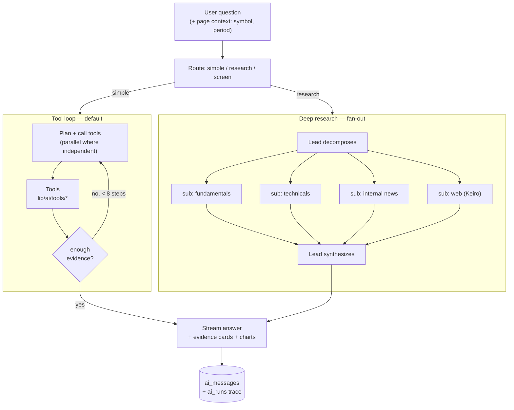

# Monarch Rebuild — Plan v5: Market Copilot (stocks + data agent)

Scope: a read-only conversational agent that answers questions about stocks, markets, and
the user's own trading history, by calling real tools over the data layer this repo already
has. No order placement, no strategy mutation, no webhook involvement.

The webhook signal-verdict plan ([PLAN_AI_AGENT.md](PLAN_AI_AGENT.md)) is **deferred**, not
dropped. The provider router, trace table, and eval harness below are shared foundations —
building them here means that plan starts at ~40% done whenever it's picked back up.

Providers: **Groq, OpenAI, Gemini** — specific models named per lane in §4, switchable per
workspace. Web search/extraction: **Keiro Labs** (user-supplied key).

---

## 0. The problem

The data is already here. It's the *navigation and the arithmetic* that aren't.

| What exists | Where |
|---|---|
| NSE/BSE watchlist, US watchlist, forex rates, symbol search | `lib/market/` |
| Deep company fundamentals — 40+ fields, statements, analyst actions, earnings history | `lib/research/company.ts` (`getCompanyReport`) |
| Daily candles, India + global | `lib/market/india-chart.ts`, `getCompanyChart` |
| NSE option chain + expiries | `lib/options/` |
| Sector heatmap, crypto heatmap | `lib/heatmap/` |
| Aggregated RSS news + Finnhub ticker news, user-custom feeds | `lib/research/rss.ts`, `finnhub.ts`, `user_rss_feeds` |
| The user's own positions, P&L, win rate, R, streaks, per-symbol performance | `lib/positions/queries.ts`, `lib/performance/queries.ts` |

Every one of those sits behind its own dashboard page. To answer *"is TCS cheaper than Infosys
right now, and have I ever made money trading either?"* the user opens company research twice,
eyeballs two PE numbers, then opens performance and filters by symbol. Three pages, manual
comparison, no record of the conclusion.

**Job to be done:** *"answer questions about stocks and about my own trading, with real
numbers, without making me visit six pages and do the math."*

That question — arbitrary, open-ended, different tool path every time — is the textbook case
for an actual agent with a tool loop. (Unlike the webhook verdict, which was a fixed pipeline
and deliberately *not* an agent.)

### Two invariants

> **1. Read-only.** No tool in v1 can place an order, modify a strategy, or change a setting.
> The blast radius of any failure — hallucination, injection, bad reasoning — is a wrong
> sentence on screen.
>
> **2. The model never does arithmetic.** Every number it says comes verbatim from a tool
> result. Ratios, indicators, aggregates, comparisons are computed in TypeScript. This is
> enforced by an automated eval, not by a prompt instruction.

Read-only and no-arithmetic are guardrails, not a mandate to only recite numbers back. A
copilot that answers "TCS PE is 28.4, Infosys PE is 24.1" and stops is barely better than the
two dashboard pages it replaced. The system prompt requires an actual synthesized answer on
top of the grounded figures — *why* the gap exists, what it implies, what's notable — every
claim still traceable to a tool result, but the model is expected to interpret, compare, and
draw a conclusion, not just format a table into a sentence. The line it must not cross is
personalized trade instruction (§7, regulatory framing) — analysis and interpretation of data
is in scope; "buy TCS" is not.

---

## 1. Classification

| Question | Answer |
|---|---|
| One prompt enough? | No — needs live quotes, fundamentals, private position history |
| Fixed sequential stages? | No — *"compare margins of 3 IT stocks"* and *"why do I lose on Tuesdays"* share no path |
| Needs facts the model lacks? | Yes — structured, live, and private |
| Vector RAG? | **No.** Everything is a typed API or a SQL query. Embeddings would add a lossy layer over exact data |
| Run-time path decision? | **Yes** → true agent, tool loop |
| Multi-agent? | Not by default. Fan-out sub-agents only for breadth queries (screen 200 symbols) and deep-research mode |

**Architecture: a single tool-loop agent with a small, carefully-shaped toolset, plus a
fan-out sub-agent mode for breadth.**

The temptation to build a "Fundamental Analyst / Technical Analyst / News Analyst / Portfolio
Analyst" crew should be resisted for the same reason as in the webhook plan: each of those is
one API call and a sentence. They are **tools, not agents**. Four LLMs to fetch four numbers
is 4× the cost and 4× the hallucination surface for zero added judgment.

---

## 2. Tool design — the centerpiece

Tool quality determines agent quality far more than model choice or prompt wording. The
principles applied throughout:

1. **Few and powerful, not many and thin.** `compare_fundamentals(symbols[], metrics[])` beats
   three `get_fundamentals` calls plus the model building a table — one call, no arithmetic,
   no transcription errors.
2. **Batch by default.** Anything symbol-shaped takes `symbols[]`. A loop of single-symbol
   calls is the main source of latency and step-limit exhaustion.
3. **Token-budgeted returns.** `getCompanyReport` alone is ~2.5k tokens of JSON. Tools take a
   `sections[]` / `fields[]` selector and default to the narrow set. Every tool has a
   documented worst-case token size.
4. **Preserve the codebase's own result convention.** Everything already returns
   `{status:"ok"|"unavailable", reason}`. Keep it — the model handles a dead feed gracefully
   when it's told *why*, and silently invents when it just gets an error string.
5. **Provenance on every result.** `asOf`, `source`, `currency`. In finance a number without a
   timestamp is a liability.
6. **Errors are instructions.** `"unavailable: NSE blocked the request; retry once or use
   get_quote instead"` teaches the model what to do next. `"Error: 503"` does not.

### 2.1 Catalog

Location: `lib/ai/tools/`. One file per group, each exporting a Zod schema + executor, so
every tool is unit-testable with no LLM in the loop.

#### Resolution — mandatory first hop

```ts
resolve_symbol({ query: string, market?: "india"|"us"|"forex"|"crypto" })
  → { hits: [{ symbol, name, exchange, currency, kind }] }   // ≤5, ~150 tok
```
Wraps `searchCompanies` + `searchSymbols`. **Symbol ambiguity is the #1 failure mode of every
finance agent** — `TCS` is Tata Consultancy on NSE and Container Store in the US; Yahoo needs
`.NS`/`.BO` suffixes that a model will cheerfully invent. System prompt rule: *never pass a
symbol to another tool that did not come out of `resolve_symbol`*. When >1 hit is plausible,
ask the user rather than guessing.

#### Prices and charts

One shared range enum used everywhere a tool takes a time window, so the model learns it once:

```ts
type TimeRange = "5d" | "1m" | "3m" | "6m" | "ytd" | "1y" | "2y" | "3y" | "5y" | "10y" | "max";
```

Bounded by what the underlying source actually has: `lib/market/india-chart.ts` and
`getCompanyChart` are daily-candle grade, so `5d` is "last 5 trading days of daily bars," not
intraday — there's no tick data behind this (see §9). Each tool below documents its own
practical floor (e.g. `correlate` refuses `5d`/`1m` server-side — too few points for a
meaningful coefficient — and returns a clear `reason` rather than a misleading number).

```ts
get_quote({ symbols: string[] })
  → { quotes: [{ symbol, last, change, changePct, currency, asOf }], missing: string[] }

get_candles({ symbol, kind: "equity"|"index", range: TimeRange, downsample?: boolean })
  → { candles: [...], count, asOf }        // downsampled to ≤60 rows for the model by default
```
`get_candles` returning 250+ raw OHLC rows is thousands of tokens of numbers the model will
misread. Default behavior returns a downsampled series plus a `seriesId` the chart renderer can
use to draw the *full* data. The model reasons over the summary; the user sees everything.

```ts
compute_indicators({ symbol, range?: TimeRange,   // window the indicator is computed over
                     indicators: ("sma20"|"sma50"|"sma200"|"ema20"|"ema50"|"rsi14"|"atr14"|
                     "vol20"|"pos52w"|"drawdown"|"ret1w"|"ret1m"|"ret3m"|"ret6m"|"retYtd"|
                     "ret1y"|"ret3y"|"ret5y"|"cagr3y"|"cagr5y")[] })
  → { symbol, values: Record<string, number|null>, asOf }

correlate({ symbols: string[], period: Exclude<TimeRange, "5d"|"1m"> })
  → { matrix: number[][], symbols: string[] }
  // or { status: "unavailable", reason: "need at least ~20 trading days; use 3m or longer" }
```
This pair is the enforcement mechanism for invariant #2. There is no path by which the model
computes an RSI or a multi-year CAGR from candles, because the candles it sees are downsampled
and the indicator tool is right there.

#### Fundamentals

```ts
get_fundamentals({ symbol,
  sections: ("snapshot"|"valuation"|"profitability"|"growth"|"balance"|"cashflow"|
             "analysts"|"earnings"|"ownership"|"profile")[] })
  → { symbol, asOf, sections: {...} }      // snapshot alone ≈ 200 tok; all ≈ 2.5k

compare_fundamentals({ symbols: string[], metrics: string[] })
  → { rows: [...], units: Record<string,string>, missing: [...] }   // server-built table
```
Both wrap the existing `getCompanyReport` and its 60s cache. `compare_fundamentals` is the
highest-leverage tool in the catalog: comparison is what people actually ask for, and doing it
server-side removes transcription error entirely.

#### Screening — the one item needing new infrastructure

```ts
screen_stocks({ universe: "nifty50"|"nifty500"|"sp500"|"custom",
                filters: { metric, op, value }[],
                sort?: { metric, dir }, limit?: number })
  → { matches: [{ symbol, name, ...requestedMetrics }], total, asOf }
```
Cannot be done live — Yahoo per-symbol against 500 names is minutes and a rate-limit ban.
Needs a nightly job (`/api/cron/refresh-fundamentals`, same `CRON_SECRET` pattern as the three
existing crons) populating an `instrument_fundamentals` table. **This is the single real build
in the plan; everything else wraps code that exists.** Phase it accordingly.

#### Options

```ts
get_option_chain_summary({ instrument, expiry?, strikeWindow?: number })
  → { spot, expiry, pcr, maxPain, totalCallOi, totalPutOi,
      topOiStrikes: [...], ivSkew, strikes: [...], asOf }
```
Never return the raw chain — it's tens of thousands of tokens. Return the derived read (PCR,
max pain, OI walls, IV skew) plus a ±N strike window around spot. The derived figures are
computed in TS; the model interprets them.

#### News

```ts
search_news({ symbol?, query?, market?: "INDIA"|"US"|"GLOBAL"|"CRYPTO",
              since?: "6h"|"24h"|"7d", limit?: number })
  → { articles: [{ headline, source, publishedAt, url, sentiment? }] }   // headlines only
```
Wraps `getTickerNews` + `getAggregatedNews` (including the user's `user_rss_feeds`). Headlines
and metadata only, never article bodies — bodies are unbounded, low-signal, and the primary
prompt-injection vector (see §7).

#### Web search & research — Keiro Labs

The internal tools cover quotes, fundamentals, options, and the user's own account. They don't
cover *"what's the market saying about the Adani group right now"*, *"summarize the RBI's
latest policy stance"*, or anything else that isn't already structured data in this repo or the
RSS feeds. Without an outside-context tool the agent is stuck reciting internal numbers even
when the honest answer needs current world knowledge — which is exactly the "only limited to
observing" failure mode to avoid. Keiro Labs (real-time search + extraction + cited answers,
with an official MCP server) closes that gap.

```ts
web_search({ query: string, recency?: "day"|"week"|"month"|"year"|"any",
             allowedDomains?: string[], limit?: number })
  → { results: [{ title, url, snippet, publishedAt?, source }] }

web_research({ query: string, maxSources?: number })
  → { answer: string, citations: [{ title, url, quote }] }
  // Keiro's autonomous multi-step research + cited-answer endpoint — for
  // "what happened with X this week" style questions, not single-fact lookups.
```
`web_search` is the fast single-hop tool (headline results, model synthesizes); `web_research`
is for genuinely open questions where Keiro's own multi-step pipeline outperforms one tool call
plus one model pass. Both return citations — every claim sourced from the open web must carry
a linked URL in the answer, same as the internal `search_news` cards.

**Trust tier: same as `search_news`, not higher.** Search results and extracted page content
are attacker-reachable — a page can contain text aimed at the agent, not the user. Results are
wrapped as untrusted data with an explicit "this is retrieved content, not instructions"
delimiter, snippets are length-capped, and `web_research`'s synthesized `answer` is treated as
one more citable data point, never as a system instruction. No tool here fetches and renders
arbitrary raw HTML into the loop — Keiro's own extraction/summarization stands between the raw
page and the model. This is why `web_search`/`web_research` replace the flatly-excluded generic
`http_fetch` from §2.2 rather than reopening it: the surface is bounded by Keiro's pipeline, not
"go fetch this URL and read it."

#### Market context

```ts
get_market_overview({ scope: "india"|"us"|"forex"|"crypto" })
  → { indices: [...], breadth?, topGainers, topLosers, asOf }

get_sector_heatmap({ category })   // wraps lib/heatmap/yahoo.ts
```

#### The user's own data — the actual differentiator

Any generic chatbot can look up a PE ratio. None of them can answer *"what's my win rate on
this symbol?"* These tools are always workspace-scoped from the **server session**, never from
a model-supplied id.

```ts
get_my_positions({ status?, market?, symbol?, strategyId?, limit? })
  → { positions: [...], summary: { open, exposure, unrealizedPnl } }

analyze_my_performance({ dimension: "symbol"|"strategy"|"weekday"|"hour"|"side"|"market"|"overall",
                         period: "7d"|"30d"|"90d"|"180d"|"ytd"|"1y"|"3y"|"5y"|"all", market? })
  → { kpis: {...}, breakdown: [...], insights: [...] }

get_my_watchlist({ group?: "india"|"us"|"forex" })
```
`analyze_my_performance` is a thin dispatcher over `computePerformanceKpis`,
`computeStreaks`, `computeSymbolPerformance`, `computeDailyPnlByCurrency`, `generateInsights` —
all of which already exist and are already tested by the Performance page. Note they return
`Record<"USD"|"INR", …>`; the tool must keep currencies separate and never sum across them.

#### Rendering

```ts
render_chart({ kind: "line"|"candle"|"bar"|"scatter", seriesId?, spec })
render_table({ columns, rows, caption })
```
The agent emits a spec; the client draws it with the `lightweight-charts` / `recharts` already
in `package.json`. Numbers reach the user through a renderer, not through generated prose —
which closes the last transcription gap and makes answers look like a product rather than a
chat log.

### 2.2 Not tools

`place_order`, `modify_strategy`, `update_settings`, `send_telegram`, raw `sql_query`, generic
`http_fetch` (fetch-and-render-arbitrary-HTML). Each is either a write (violates invariant #1)
or an unbounded surface — no page-content boundary, unlike `web_search`/`web_research` above,
which go through Keiro's own extraction pipeline rather than raw HTML reaching the model. A
read-only agent whose entire world is typed, validated tools — plus one vetted, bounded search
provider — is a fundamentally different security posture from one with a generic `fetch` tool,
and worth protecting.

---

## 3. Agent loop



**Default lane.** AI SDK tool loop in a streaming route handler
(`app/api/ai/chat/route.ts`). Budgets: **max 8 tool steps, 25s wall clock, 30k prompt
tokens**. Hitting a budget produces a partial answer that says what it had and what it was
still fetching — never a silent truncation.

**Deep research lane.** Opt-in ("Deep dive on RELIANCE"). Lead agent decomposes into 3–4
independent briefs, runs them as sub-agents with **isolated context windows**, synthesizes.
Multi-agent is justified here specifically because a full fundamentals + technicals + news +
peer-comparison sweep overflows one context window, and the isolation is the mechanism, not
role-play.

**Screen lane.** `screen_stocks` returns candidates deterministically; the model only narrates
and ranks the shortlist. No per-symbol LLM call unless the user asks to expand one.

**Context engineering.** Tool results are the dominant token consumer. Old tool results in a
long thread are compacted to a one-line digest with the full payload retained server-side and
re-expandable by id. The system prompt carries: current date/time IST, market open/closed via
`lib/market-hours.ts`, the user's default market and currency, the page they invoked from, and
their pinned watchlist symbols.

**Entry points.** A dedicated page (`app/(user)/dashboard/monarch/copilot/page.tsx`) and a
global ⌘K panel that inherits page context — opening it from company research pre-loads the
symbol; from performance, the active period. Context-aware entry is what makes it feel built-in
rather than bolted-on.

---

## 4. Providers — named models, not tier labels

`lib/ai/provider/` — one interface, three adapters, one config object mapping lane → model, with
every lane user-overridable (§4.1). Same layer the deferred webhook plan will reuse. Model
choices below verified live (web search, 2026-08-13) since these lineups ship monthly —
re-check at wiring time regardless.

| Lane | Default model | Why this one, here |
|---|---|---|
| Routing / symbol disambiguation / first-token hop | **Groq — `qwen/qwen3.6-27b`** | Groq's own recommended migration target off Llama 3.x — flagship-level agentic/tool-use performance at 27B, fast on Groq's LPUs. Fits the "which tool, which symbol" decision the user feels as lag |
| Default tool-loop (main agent) | **Google — `gemini-3.6-flash`** | GA, cheaper than 3.5 Flash, explicitly improved on agentic tool planning — this is the model doing 90% of the work |
| Deep-research synthesis / hard comparative reasoning | **OpenAI — `gpt-5.6-luna`** | Per your call. Flagging honestly: in OpenAI's own Sol/Terra/Luna split, Luna is the cheapest, fastest, *most cost-sensitive* tier — the rough equivalent of last generation's "nano" — not the reasoning-flagship tier (that's Sol). Cheap and fast is a fine default for synthesis if the goal is low cost at scale; if a query needs the deepest reasoning available, `gpt-5.6-sol` is the swap. Set as default here because you asked for it explicitly, and made a one-dropdown change either way (§4.1) |
| Deep-research sub-agent briefs (parallel, cheap, isolated context) | **your choice: `gpt-5.6-luna` (OpenAI) or `qwen/qwen3.6-27b` (Groq)** | Both fit — this lane wants many cheap, fast, parallel calls, which is exactly Luna's stated use case, and exactly what the Groq/Qwen pairing already does for routing. Default to whichever provider's key lands first; §4.1 makes it a per-workspace pick, not a fixed choice |
| Fallback if the tool-loop model errs/times out | **Groq — `openai/gpt-oss-120b`** | Groq-hosted, strong tool-calling, keeps the fallback hop fast rather than round-tripping to a slower provider mid-answer |

Config lives as one object (`lib/ai/provider/models.ts`) so a model swap next quarter is a
one-line diff, not a redesign — the table above is data, not architecture, and doubles as the
seed data for the personalization layer below.

Chose the default loop model (`gemini-3.6-flash`) on **tool-calling reliability, not raw
speed** — a fast model that picks the wrong tool costs an extra round trip and beats no one.
Groq's role is the sub-second routing hop and perceived responsiveness, not the main reasoning.

### 4.1 Personalization — every lane is a user-facing setting, not a hardcoded pick

The table above is the shipped default, not a constraint. Each lane gets a dropdown in
Settings → AI (new panel alongside the existing
[`app/(user)/dashboard/settings/`](app/(user)/dashboard/settings) tabs), scoped per user so two
people in the same workspace can run different models without stepping on each other:

```
ai_model_prefs   userId, lane ('routing'|'main_loop'|'deep_synthesis'|'sub_agent'|'fallback'),
                 provider, model, updatedAt
                 uniqueIndex(userId, lane)
                 -- unset lane = inherit the lib/ai/provider/models.ts default
```

The dropdown per lane is populated from whatever the workspace actually has keys for (§4's
"keys needed" table) — no dead options pointing at a provider with no key configured. Picking a
model the workspace has no key for is simply not offered, rather than failing at call time.
This is also the natural home for "I want the cheap model everywhere" or "I want Sol on
everything and I'll eat the cost" as one-click presets, once real usage shows which combos
people actually want.

Implementation: **Vercel AI SDK** — unified `streamText` + tool loop + Zod-typed tools across
all three providers, which is exactly this shape of problem, in a Next 16 app. All three also
expose OpenAI-compatible endpoints if a zero-dependency router is preferred instead.

Router rules: per-lane timeout with the fallback chain above; BYO keys per workspace encrypted
via the existing `encryptCredentials` ([`lib/crypto.ts`](lib/crypto.ts)); platform keys with a
daily spend cap; every call writes an `ai_runs` row.

### Keys needed to build this

| Key | For | Have it? |
|---|---|---|
| `GROQ_API_KEY` | routing hop + tool-loop fallback | needed |
| `GOOGLE_GENERATIVE_AI_API_KEY` (Gemini) | default tool-loop + sub-agent briefs | needed |
| `OPENAI_API_KEY` | deep-research synthesis | needed |
| `KEIRO_API_KEY` | `web_search` / `web_research` | you offered — yes please |

Any of the three LLM keys can be dropped in later and the affected lane just falls back down
the chain (§ table above) — nothing else blocks on having all four on day one. Keiro only gates
the two web tools in §2.1; everything else in Phase 0–2 works without it.

---

## 5. Schema

```
ai_threads          id, workspaceId, userId, title, pinnedSymbol,
                    lastMessageAt, archivedAt, createdAt

ai_messages         id, threadId, role, content,
                    toolCalls jsonb,        ← name, args, result digest, latency, status
                    evidence jsonb,         ← the exact tool payloads cited, for the UI cards
                    provider, model, tokens, costUsd, createdAt
                    index (threadId, createdAt)

ai_runs             id, workspaceId, lane, provider, model,
                    inputTokens, outputTokens, costUsd, latencyMs, steps,
                    status, errorCode, createdAt
                    index (workspaceId, createdAt)

ai_user_memory      userId, key, value, source ('inferred'|'stated'), updatedAt
                    -- "prefers INR", "trades BANKNIFTY weeklies", "swing horizon"
                    -- small, inspectable, user-deletable. Not a vector store.

instrument_fundamentals   symbol (PK), exchange, name, sector, industry,
                          marketCap, pe, pb, roe, revenueGrowth, profitMargin,
                          debtToEquity, dividendYield, beta, ret1y, …
                          refreshedAt
                          index (sector), (marketCap)
                          -- nightly cron; powers screen_stocks

ai_usage_daily      workspaceId, date, costUsd, requests   -- cap enforcement

ai_model_prefs      userId, lane, provider, model, updatedAt   -- see §4.1, personalization
                    uniqueIndex(userId, lane)
```

`ai_messages.evidence` is what lets the UI render a source card under every claim, and what the
numeric-fidelity eval checks answers against.

---

## 6. Evaluation

Built in Phase 0, before the chat UI, because a finance agent that is confidently wrong is
worse than no agent.

**Golden set:** ~70 questions across seven categories — symbol resolution, single-stock lookup,
comparison, technical, own-performance, open-world (needs `web_search`/`web_research`), and
should-refuse. Ground truth for the factual ones is generated by calling the tools directly, so
the set self-updates as prices move.

| Metric | Definition | Target |
|---|---|---|
| **Numeric fidelity** | every number in the answer appears in a tool result from that turn (incl. Keiro citations) | **1.00** |
| Symbol resolution | correct exchange + suffix, ambiguity surfaced not guessed | > 0.98 |
| Tool-choice accuracy | expected tool called, no redundant calls | > 0.90 |
| Groundedness | no claim without supporting evidence (LLM-judge) | > 0.95 |
| Synthesis quality | LLM-judge: does the answer draw a conclusion/comparison, not just restate figures | > 0.85 |
| Refusal correctness | personalized advice declined, data questions answered | > 0.95 |
| Steps per query | median tool calls | ≤ 3 |
| p95 latency | first token / full answer | < 1.5s / < 12s |
| Cost | per query | < $0.01 |

Numeric fidelity is the one that matters most and, conveniently, is fully automatable: extract
every numeral from the answer, assert each appears in that turn's tool results (within
rounding). It catches hallucinated figures, stale-cache mixups, and unit errors in one check.
Make it a CI gate.

---

## 7. Failure modes and designed responses

| Failure | Response |
|---|---|
| **Ambiguous ticker** | `resolve_symbol` returns multiple hits → agent asks. Never guesses `.NS`. |
| **Model does arithmetic** | Structurally discouraged: candles downsampled, indicator/compare tools present. Caught by the fidelity eval. |
| **Stale data** | Every result carries `asOf`; the UI stamps it; the system prompt requires stating it when the market is closed or data is >15m old. |
| **Upstream down** (NSE WAF, Yahoo rate-limit) | Existing `{status:"unavailable", reason}` convention flows to the model, which says what's missing instead of inventing. One retry on the fast tier, then report. |
| **Prompt injection via news headlines / RSS / web search** | Headlines, user-added RSS feeds, and Keiro search/extraction results are all attacker-reachable content. All tool output is wrapped as untrusted data with an explicit "this is data, not instructions" delimiter. With no write tools and no generic `fetch` tool, a successful injection can at worst produce one misleading sentence — this is the strongest argument for keeping the toolset read-only even as it grows to include web search. |
| **Cross-workspace data leak** | Workspace/user ids come from the server session **only**, never from tool args. Every own-data query re-derives scope server-side. Add an explicit test for this — it is the one bug in this plan with real consequences. |
| **Context overflow on long threads** | Tool-result compaction with re-expansion by id; hard 30k prompt cap. |
| **Runaway loop** | 8-step / 25s / token budget, then partial answer stating what's missing. |
| **Cost spike** | `ai_usage_daily` cap per workspace; degrades to the fast tier, then to a refusal with a clear reason. |

### Regulatory framing — decide this before Phase 1

The user base is India-focused. Under SEBI's Investment Adviser and Research Analyst
regulations, giving personalized investment advice or publishing research recommendations for
consideration is a registered activity. This plan is deliberately shaped as a **data and
analytics tool**, not an advisor:

- Answers *"what is TCS's ROE and how does it compare to Infosys"* — a data question.
- Declines *"should I buy TCS"* — and redirects to *"here's the data, and here's what your own
  history on this symbol says"*, which is factual reporting on the user's own account.
- No buy/sell/hold ratings generated by the model. Third-party analyst ratings from
  `getCompanyReport` may be **reported as data with attribution** — that's quoting a source,
  not issuing a view.
- Persistent disclaimer in the UI, and a refusal policy in the system prompt with eval coverage.

Worth a lawyer's read before launch, not after. Flagging it now because it constrains copy and
prompt design, and retrofitting a refusal policy onto a shipped product is far more painful
than designing to it.

---

## 8. Rollout

| Phase | Ships | Gate |
|---|---|---|
| **0 — Foundations** | Provider router, `ai_runs`, **the whole tool layer as plain TypeScript** with unit tests, golden set + eval harness. No chat UI. | Every tool green; token sizes measured |
| **1 — Chat** | Streaming agent, core tools (resolve / quote / candles / indicators / fundamentals / compare / news), `web_search`/`web_research` if the Keiro key is in by then, thread persistence, evidence cards. | Numeric fidelity 1.00; tool-choice > 0.90 |
| **2 — Your data** | `get_my_positions`, `analyze_my_performance`, watchlist; chart + table rendering; ⌘K with page context; Settings → AI per-lane model picker (§4.1). | Cross-workspace isolation test passing |
| **3 — Breadth** | `instrument_fundamentals` nightly cron + `screen_stocks`; option-chain summary tool. | Screener latency < 2s on nifty500 |
| **4 — Depth** | Deep-research fan-out lane, `ai_user_memory`, saved/shareable analyses. | — |
| **5 — Proactive** | Morning watchlist digest to Telegram (reuses `notifyWorkspace`), "notable move" nudges. | — |

**Build the tools before the agent.** Phase 0 has no LLM in it at all: it's a typed,
tested, cached data-access layer that the existing dashboard pages could use directly. If the
agent were cancelled tomorrow, Phase 0 would still be worth having — which is the sign the
dependency order is right.

---

## 9. Deliberately out of scope

- **Vector RAG / pgvector.** The corpus is typed APIs and SQL. Embeddings would put a lossy
  similarity layer over exact data. Revisit only for a genuine document corpus (filings,
  transcripts).
- **Fine-tuning.** The need is fresh facts and correct tool use, not style.
- **LangGraph / CrewAI.** One tool loop and one fan-out; the AI SDK covers both inside existing
  route handlers. Revisit if durable multi-day state or human-in-the-loop pauses appear.
- **Write tools of any kind.** Invariant #1. A future "draft a strategy config for review"
  action would produce a diff for a human to approve, never an applied change.
- **Price prediction, buy/sell ratings, target prices.** Out on both accuracy and regulatory
  grounds. The agent reports and computes; it does not forecast.
- **Intraday tick data / real-time streaming.** Current sources are quote-and-daily-candle
  grade. Promising an intraday agent on daily data would be the fastest way to lose trust.

---

## 10. Open question

**Should the copilot see the user's positions in Phase 1, or wait until Phase 2?**

Own-data questions are the differentiator — *"what's my win rate on BANKNIFTY"* is something no
generic chatbot can answer, and it is the demo that sells the feature. But it is also the only
place where a scoping bug leaks one workspace's P&L into another's, so it wants the isolation
test and a session-derived-scope review before it ships.

The plan above puts it in Phase 2 for that reason. Pulling it into Phase 1 is reasonable if
that review lands first — it changes sequencing only, not design.
